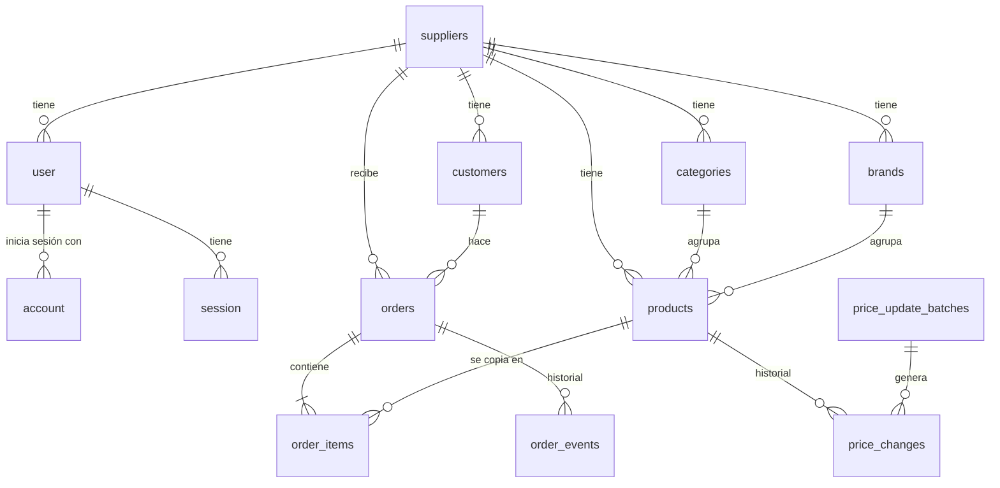

# Modelo de datos

PostgreSQL. Tablas y campos en inglés. Todas las tablas tienen `created_at` y `updated_at` (timestamptz).

## suppliers (proveedores)

| Campo             | Tipo                 | Nota                            |
| ----------------- | -------------------- | ------------------------------- |
| id                | uuid                 |                                 |
| name              | text                 | Nombre comercial                |
| whatsapp_phone    | text                 | Formato internacional (549351…) |
| logo_url          | text, opcional       |                                 |
| plan              | enum, default `free` | Para planes futuros             |
| use_brands        | bool, default `true` |                                 |
| use_categories    | bool, default `true` |                                 |
| uses_own_codes    | bool                 | Si maneja códigos propios       |
| next_product_code | int                  | Contador para códigos generados |
| next_order_number | int                  | Contador de pedidos             |
| is_active         | bool                 | Suspensión por el admin         |

## Autenticación (Better Auth)

Better Auth crea y maneja sus tablas. Las generamos con su CLI para el esquema de Drizzle y no se editan a mano, salvo los campos adicionales de `user`.

### user (usuarios del panel)

| Campo          | Tipo                   | Nota                                        |
| -------------- | ---------------------- | ------------------------------------------- |
| id             | text                   | Lo genera Better Auth                       |
| name           | text                   |                                             |
| email          | text, único            |                                             |
| email_verified | bool                   |                                             |
| image          | text, opcional         |                                             |
| supplier_id    | uuid                   | Campo adicional: proveedor al que pertenece |
| role           | enum `owner` / `staff` | Campo adicional                             |

### account (formas de inicio de sesión)

Una fila por cada forma de entrar del usuario: contraseña o, más adelante, Google. La contraseña se guarda como _hash_, nunca en texto plano.

### session

Sesiones activas por dispositivo, con vencimiento.

### verification

Tokens temporales: recuperación de contraseña y verificación de email.

## customers (kiosqueros)

| Campo                               | Tipo                        | Nota                      |
| ----------------------------------- | --------------------------- | ------------------------- |
| id, supplier_id                     | uuid                        |                           |
| business_name                       | text                        |                           |
| contact_name, phone, address, notes | text                        |                           |
| price_list                          | enum `wholesale` / `retail` |                           |
| discount_pct                        | numeric(5,2), default 0     |                           |
| access_token                        | text, único                 | 32+ caracteres aleatorios |
| is_active                           | bool                        |                           |
| last_seen_at                        | timestamptz                 |                           |

## categories y brands

| Campo           | Tipo | Nota                        |
| --------------- | ---- | --------------------------- |
| id, supplier_id | uuid |                             |
| name            | text | `unique(supplier_id, name)` |
| sort_order      | int  | Solo categorías             |

## products (artículos)

| Campo                 | Tipo                         | Nota                                                                 |
| --------------------- | ---------------------------- | -------------------------------------------------------------------- |
| id, supplier_id       | uuid                         |                                                                      |
| code                  | text                         | `unique(supplier_id, code)` normalizado; clave del cruce al importar |
| code_is_generated     | bool                         | Si lo generó el sistema                                              |
| name                  | text                         |                                                                      |
| brand_id, category_id | uuid, opcional               | `NULL` = sin marca / sin categoría                                   |
| presentation          | text, opcional               | "Caja x 24", "Horma"                                                 |
| units_per_pack        | int, opcional                |                                                                      |
| pricing_unit          | enum `unit` / `kg`           |                                                                      |
| order_mode            | enum `unit` / `piece` / `kg` | Cómo lo pide el kiosquero                                            |
| avg_piece_weight_kg   | numeric(8,3), opcional       |                                                                      |
| wholesale_price       | numeric(12,2)                | Por unidad o por kilo                                                |
| retail_price          | numeric(12,2), opcional      | Vacío = mayorista                                                    |
| is_available          | bool                         | Sin stock                                                            |
| is_active             | bool                         | Baja lógica                                                          |
| image_url             | text, opcional               |                                                                      |

## price_update_batches (operaciones de precio)

| Campo           | Tipo                                 | Nota                                  |
| --------------- | ------------------------------------ | ------------------------------------- |
| id, supplier_id | uuid                                 |                                       |
| kind            | enum `increase` / `import`           |                                       |
| description     | text                                 | "+8 % Arcor", "Importación del 02/11" |
| percentage      | numeric(6,2), opcional               | Vacío en importaciones                |
| rounding        | int, opcional                        | Múltiplo en pesos: 10, 50, 100        |
| rounding_mode   | enum `up` / `nearest`, opcional      | Dirección; vacío si no hubo redondeo  |
| target          | enum `wholesale` / `retail` / `both` |                                       |
| affected_count  | int                                  |                                       |
| created_by      | text                                 | `user.id`                             |
| reverted_at     | timestamptz, opcional                | Para deshacer                         |

## price_changes (historial de precios)

| Campo                        | Tipo           | Nota                            |
| ---------------------------- | -------------- | ------------------------------- |
| id, product_id               | uuid           |                                 |
| batch_id                     | uuid, opcional | Vacío si fue edición individual |
| old_wholesale, new_wholesale | numeric(12,2)  |                                 |
| old_retail, new_retail       | numeric(12,2)  |                                 |
| created_by                   | text           | `user.id`                       |

## orders (pedidos)

| Campo                                 | Tipo                                   | Nota                                                                                   |
| ------------------------------------- | -------------------------------------- | -------------------------------------------------------------------------------------- |
| id, supplier_id, customer_id          | uuid                                   |                                                                                        |
| number                                | int                                    | `unique(supplier_id, number)`                                                          |
| status                                | enum                                   | `draft`, `sent`, `changes_requested`, `accepted`, `delivered`, `rejected`, `cancelled` |
| created_by                            | enum `customer` / `supplier`           |                                                                                        |
| price_list, discount_pct              |                                        | Copia de cómo se calculó                                                               |
| extra_discount_pct                    | numeric(5,2), opcional                 | Descuento al aceptar                                                                   |
| subtotal, discount_amount             | numeric(12,2)                          |                                                                                        |
| estimated_total                       | numeric(12,2)                          | Al enviar                                                                              |
| final_total                           | numeric(12,2), opcional                | Tras pesar o ajustar                                                                   |
| customer_notes, supplier_notes        | text                                   |                                                                                        |
| sent_at, accepted_at, delivered_at    | timestamptz, opcional                  |                                                                                        |
| expected_delivery_date                | date, opcional                         |                                                                                        |
| payment_method                        | enum, opcional                         | Efectivo, transferencia, otro                                                          |
| payment_status                        | enum `pending` / `paid`                | Default `pending`                                                                      |
| rejection_reason, cancellation_reason | text, opcional                         |                                                                                        |
| cancelled_by                          | enum `customer` / `supplier`, opcional |                                                                                        |
| version                               | int                                    | Control de ediciones simultáneas                                                       |

## order_items (líneas)

| Campo                                               | Tipo                                    | Nota                                        |
| --------------------------------------------------- | --------------------------------------- | ------------------------------------------- |
| id, order_id, product_id                            | uuid                                    |                                             |
| code, name, presentation, brand_name, category_name | text                                    | Copia al enviar                             |
| pricing_unit, order_mode                            | enum                                    | Copia                                       |
| unit_price                                          | numeric(12,2)                           | Con lista y descuento; se congela al enviar |
| quantity                                            | numeric(10,3)                           | Unidades, piezas o kilos                    |
| original_quantity                                   | numeric(10,3)                           | Lo que pidió el cliente                     |
| line_status                                         | enum `ok` / `out_of_stock` / `replaced` |                                             |
| replaces_product_id                                 | uuid, opcional                          | Original cuando hubo reemplazo              |
| estimated_weight_kg                                 | numeric(10,3), opcional                 |                                             |
| actual_weight_kg                                    | numeric(10,3), opcional                 |                                             |
| estimated_line_total, final_line_total              | numeric(12,2)                           |                                             |

## order_events (historial del pedido)

| Campo                     | Tipo                         | Nota                                                                                                                                              |
| ------------------------- | ---------------------------- | ------------------------------------------------------------------------------------------------------------------------------------------------- |
| id, order_id, supplier_id | uuid                         |                                                                                                                                                   |
| event_type                | enum                         | `created`, `sent`, `edited`, `changes_requested`, `item_replaced`, `accepted`, `weighed`, `delivered`, `payment_updated`, `rejected`, `cancelled` |
| from_status, to_status    | enum, opcional               |                                                                                                                                                   |
| actor                     | enum `customer` / `supplier` |                                                                                                                                                   |
| actor_user_id             | text, opcional               | `user.id`                                                                                                                                         |
| note                      | text, opcional               |                                                                                                                                                   |
| changes                   | jsonb, opcional              | Detalle de cambios                                                                                                                                |
| created_at                | timestamptz                  |                                                                                                                                                   |

## Decisiones de diseño

- **Copias en el pedido**: cada línea guarda código, nombre, marca, categoría y precio del momento.
- **Dos identificadores**: `id` uuid interno e inmutable; `code` visible. Todo artículo tiene código (propio o generado). Cambiar un código no rompe el historial. El EAN, si se suma, va aparte.
- **Marca y categoría con `NULL`**, no registros falsos.
- **Usuarios con Better Auth**: se usa su tabla `user` extendida con `supplier_id` y `role`, en lugar de una tabla `users` propia, para no duplicar datos. Las contraseñas las maneja Better Auth (hash en `account`). Los campos que apuntan a un usuario son `text`.
- **Dinero en `numeric`**, nunca `float`.
- **`supplier_id` en todas las tablas** e índices que empiecen por él.
- **Totales en el servidor**.
- **Baja lógica** de artículos y clientes.
- **Búsqueda** con índice `pg_trgm` sobre el nombre.
- **Historial de precios desde el día 1**.
- **Control de concurrencia** en pedidos con `version` (o verificando el estado) al guardar.
- **Seed** con un proveedor, ~200 artículos (algunos por peso, algunos sin marca) y clientes de ambas listas.
